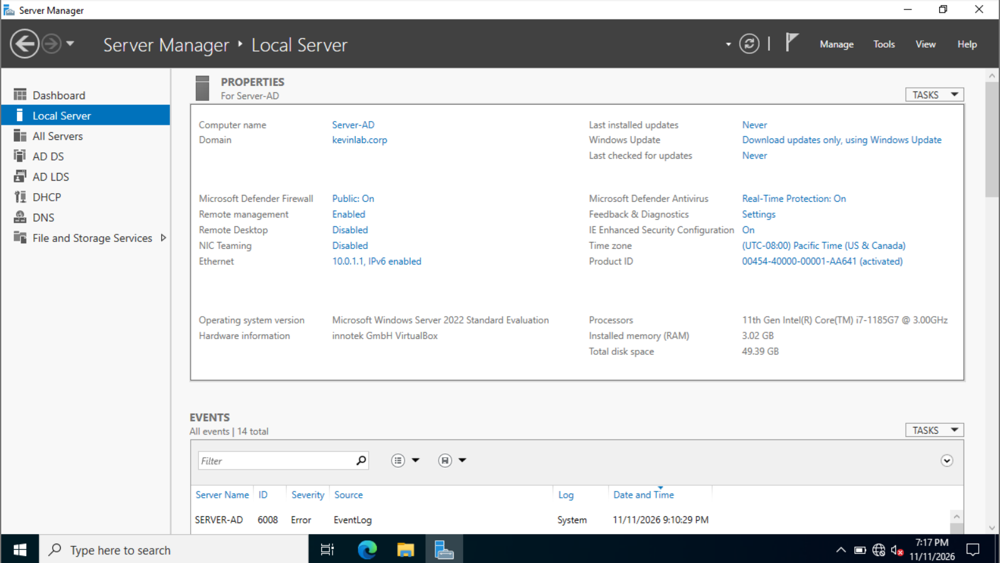
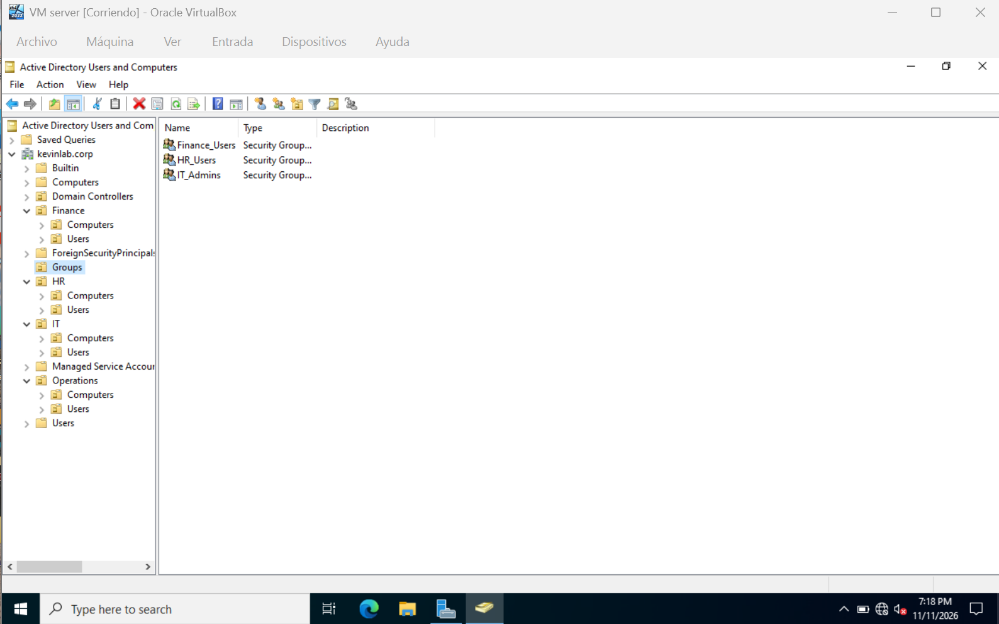
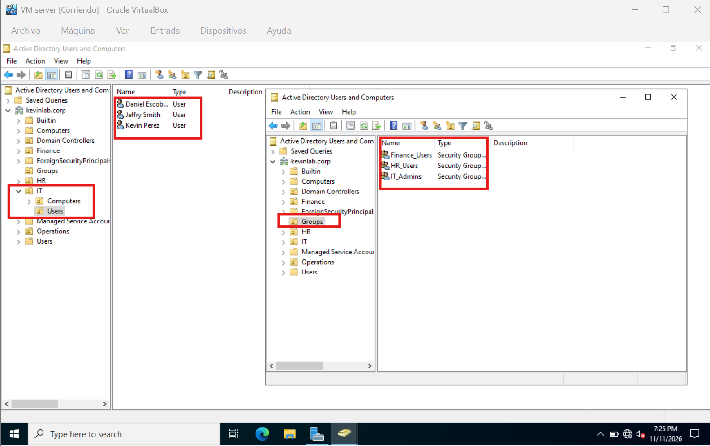
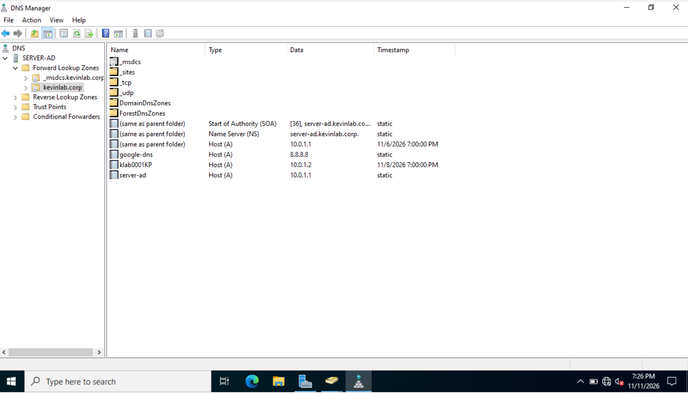
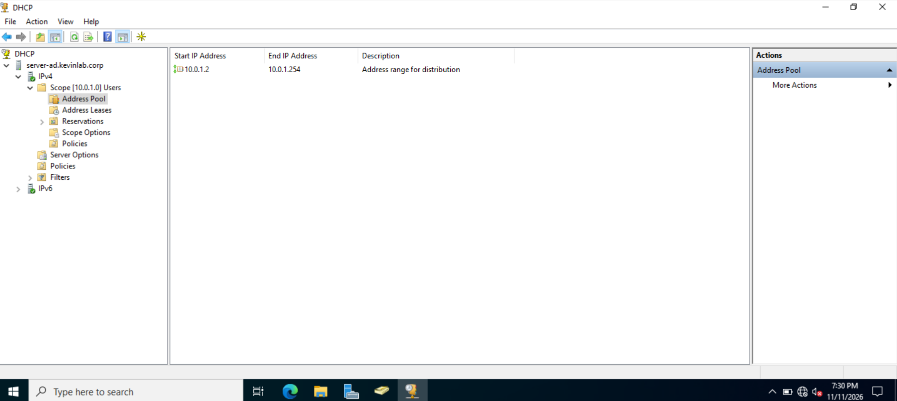
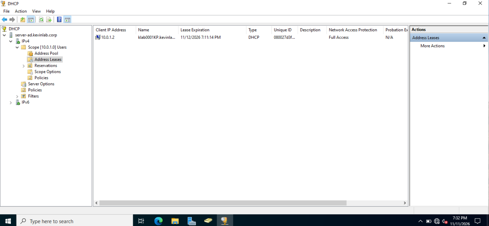
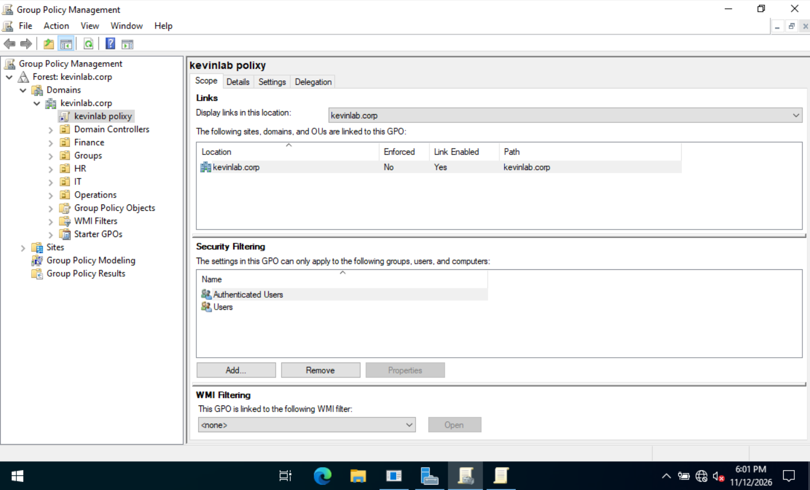
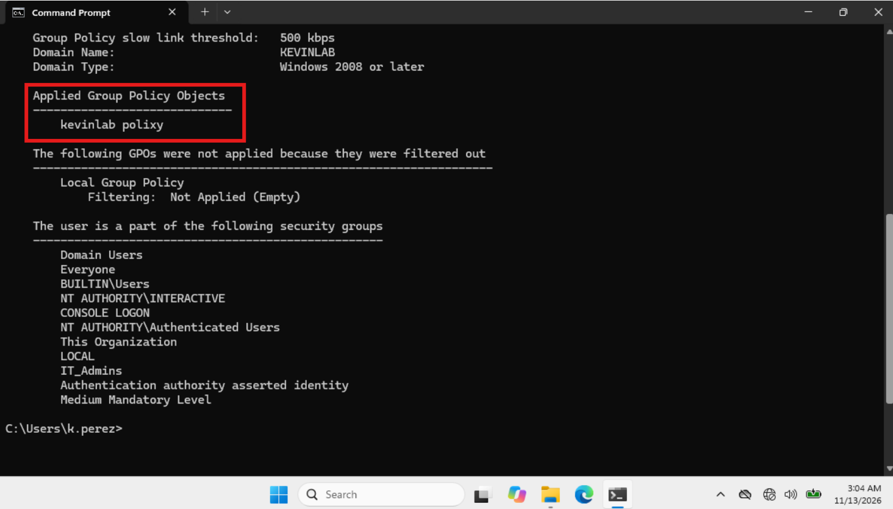

# Windows Server Administration Lab

## Project Overview

This project demonstrates hands-on experience configuring and administering a Windows Server 2022 environment.

The lab focuses on core Windows Server infrastructure services, including Active Directory Domain Services (AD DS), DNS, DHCP, and Group Policy Objects (GPOs).

The objective was to build a centralized Windows domain environment, manage users and groups, configure network services, and apply administrative policies to domain resources.

## Environment

- **Operating System:** Windows Server 2022 (Desktop Experience)
- **Directory Services:** Active Directory Domain Services (AD DS)
- **Name Resolution:** Domain Name System (DNS)
- **IP Address Management:** Dynamic Host Configuration Protocol (DHCP)
- **Policy Management:** Group Policy Management (GPMC)
- **Virtualization:** Oracle VirtualBox
- **Client Environment:** Windows Client VM

## Implemented Configurations

### 1. Windows Server Installation and Configuration

- Installed and configured Windows Server 2022.
- Reviewed installed server roles and management tools.
- Prepared the server environment for domain infrastructure services.

### 2. Active Directory Domain Services

- Installed and configured Active Directory Domain Services.
- Promoted the server to a Domain Controller.
- Created and organized the Active Directory structure.
- Created domain user accounts and security groups.

### 3. DNS Configuration

- Configured DNS for the Active Directory domain environment.
- Reviewed DNS zones and domain name resolution settings.
- Verified DNS configuration for domain infrastructure.

### 4. DHCP Configuration

- Installed and configured the DHCP Server role.
- Created and configured a DHCP scope.
- Reviewed active DHCP address leases.
- Verified dynamic IP address assignment on the client machine.

### 5. Group Policy Management

- Accessed and configured Group Policy Management.
- Created and managed Group Policy Objects.
- Linked policies to the appropriate Active Directory organizational units.
- Verified Group Policy application in the domain environment.

## Screenshots

### 01. Server Manager

Overview of the Windows Server environment and installed server roles.

### 02. Active Directory Structure

Overview of the Active Directory organizational structure.

### 03. Active Directory Users and Groups

Domain user accounts and security group management.

### 04. DNS Configuration

DNS configuration for domain name resolution.

### 05. DHCP Scope Configuration

Configured DHCP scope and IP address distribution settings.

### 06. DHCP Address Leases

Overview of dynamically assigned IP addresses and DHCP leases.

### 07. Client IP Configuration

Verification of the IP address dynamically assigned to the Windows client.

### 08. Group Policy Management

Overview of configured Group Policy Objects and management settings.

### 09. Group Policy Verification

Verification of Group Policy application in the Windows domain environment.

## Skills Demonstrated

- Windows Server Administration
- Active Directory Domain Services (AD DS)
- User and Group Management
- Domain Controller Configuration
- DNS Administration
- DHCP Administration
- IP Address Management
- Group Policy Objects (GPO)
- Windows Client Domain Integration
- Infrastructure Troubleshooting

## Project Purpose

This lab was developed as part of my continuous learning journey in Systems Administration and Cloud Infrastructure, focusing on practical Windows Server administration and enterprise infrastructure fundamentals.
